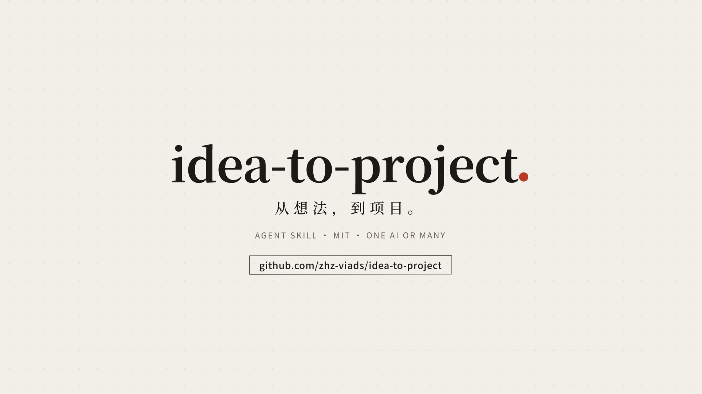

# 想法到项目 · idea-to-project

[](media/idea-to-project.mp4)

观看 51 秒介绍 / Watch the 51-second intro.

把一个还说不清的想法，整理成一个具体项目和一份能直接交给 AI 使用的提示词。

适合这样的起点：知道想解决什么问题，却还没想好做成网页、软件、工具，还是一套流程。先判断这件事值不值得做，再把方向、结构、取舍和验收说清楚。

这是一个纯文档技能。复制即可使用，没有运行服务、安装脚本或生产依赖。

## 两种用法

**没有指定参与者时，先按单 AI 推进。** 当前 AI 根据已有材料澄清关键缺口，给出有实质区别的方向，再写好提示词。只要提示词时，交付文本即止；已经授权实施时，按确认的范围继续。

**也可以指定多个 AI 参与。** 先各自出主意，再交换方案、直接指出问题，最后收束成一个具体项目。交付附带各方对“值不值得做”的判断和理由，以及关键取舍的对比表。默认共两轮，必要时补第三轮；没有实际回复的参与者会被明确标出。

未指定参与者时，AI 会说明可以邀请多方，并按任务建议人数；例如，有几个方向需要比较时，可建议两到三位，但不会因此停下来等你选择或自行增派。普通聊天也能协作，分别复制材料给各位参与者，再把回复交回主控即可。传话方式不限于任何产品或通道。

## 开始使用

支持 Agent Skills 的客户端：将整个 `idea-to-project` 目录放进客户端支持的技能目录，保留其中的许可证，按该客户端的说明重新加载。目录结构遵循 [Agent Skills 规范](https://agentskills.io/specification)。

普通聊天：提供 [SKILL.md](idea-to-project/SKILL.md)，让 AI 按它处理你的想法。多方协作时同时提供 [WORKFLOW.md](idea-to-project/WORKFLOW.md)。文件传递方式由你选择。

例如，你可以这样开始。这些是通用示例：

```text
用 idea-to-project 整理这个想法：我想让一个小团队更容易找到重复采购的原因。
先给我一个具体项目和成品级提示词，暂时不实施。单 AI 完成。
```

```text
用 idea-to-project 组织三个 AI 一起构思一个阅读记录工具。
参与者是 AI A、AI B、AI C，由 AI A 主控。
每方先独立判断值不值得做，各出两个方向，再交换意见。
最后给我一个项目、一份关键取舍对比表和完整提示词；我确认项目后再实施。
```

若已有明确方向，也可以说“直接出”：AI 会列出采用的默认值后交付，只有缺少无法代填的事实或超出授权时才停下。

### 第 1 轮可直接粘贴给各参与者的消息模板

指定参与者后，把下面的原始需求和硬限制填好，分别发给每位参与者。各方拿到的这两部分应保持一致，先不要附上主控或其他人的方向。

```text
这是第 1 轮独立构思。请先不参考其他参与者的方案，也不猜主控倾向。

用户原需求：
【粘贴用户原话，保留上下文中已经明确的目标】

硬限制：
【列出已确认的预算、平台、期限、必需条件和不能做的事；没有就写“暂无”】

请先用一两句独立判断这件事值不值得做，并给出最有力的一两条理由。
如果现有办法已经足够，请直接说明，并提出更省的替代办法。
再给出 2～3 个实质不同的方向，分别写清做成什么、给谁用、
主要组成、代价和需要验证的前提。
本轮只提交你自己的判断和方案，不替其他参与者表态，不开始实施。
```

## 最后拿到什么

- 一个具体项目：做给谁、解决什么问题、包含哪些部分、做到什么程度。
- 各方对“值不值得做”的判断及理由，保留不同意见和未收到回复的情况。
- 一份关键取舍对比表：选了什么、备选来自谁、代价是什么、哪些仍有分歧。
- 一份填好实际内容的提示词：输入材料、方向、结构、关键要求、验收和第一步。
- 进入实施时的分工与复查安排：谁改哪些文件、谁独立检查、如何报告结果。

## 文件入口

| 文件 | 用途 |
| --- | --- |
| [SKILL.md](idea-to-project/SKILL.md) | 技能入口、模式选择和提示词自审 |
| [WORKFLOW.md](idea-to-project/WORKFLOW.md) | 多 AI 独立构思、争论、收束、交接与交叉复查 |
| [提示词模板](idea-to-project/references/prompt-templates.md) | 网站、应用界面、软件、后端和功能需求的写法 |
| [方法来源](idea-to-project/references/SOURCES.md) | 公开参考、许可证说明和复用边界 |

## 使用边界

AI 的多数意见不代表事实正确，也不创造实施权限。参与者可以反驳用户，也可以反驳同伴，但要给出与当前任务有关的理由或证据。

新项目的方向应交给用户决定；已经明确授权的范围不重复确认。删除重要数据、发布、付费、对外通信、账号及安全设置等动作，仍需核对用户的明确授权，不能靠共识或换一个执行者绕过被拒绝的操作。

这套文档不保证模型表现。当前提供的是流程和模板；实际效果需要结合你的任务、参与模型和工具验证。它不会自动创建其他会话或执行项目。

## English

**idea-to-project** turns a rough idea into one concrete project, a decision comparison, and an execution-ready prompt. It proceeds with one AI unless you specify participants. The optional multi-AI mode combines independent proposals, evidence-based disagreement, and cross-review, while preserving each participant's assessment of whether the project is worth doing. This is a portable documentation skill with no runtime dependencies or messaging implementation.

## 许可证

署名：**z-fdg**。原创文档与模板按 [MIT License](LICENSE) 发布。外部参考材料保留各自的许可条件，详见[方法来源](idea-to-project/references/SOURCES.md)。
